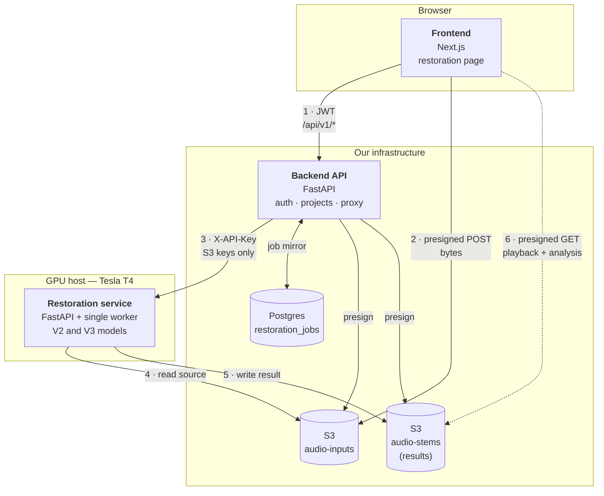
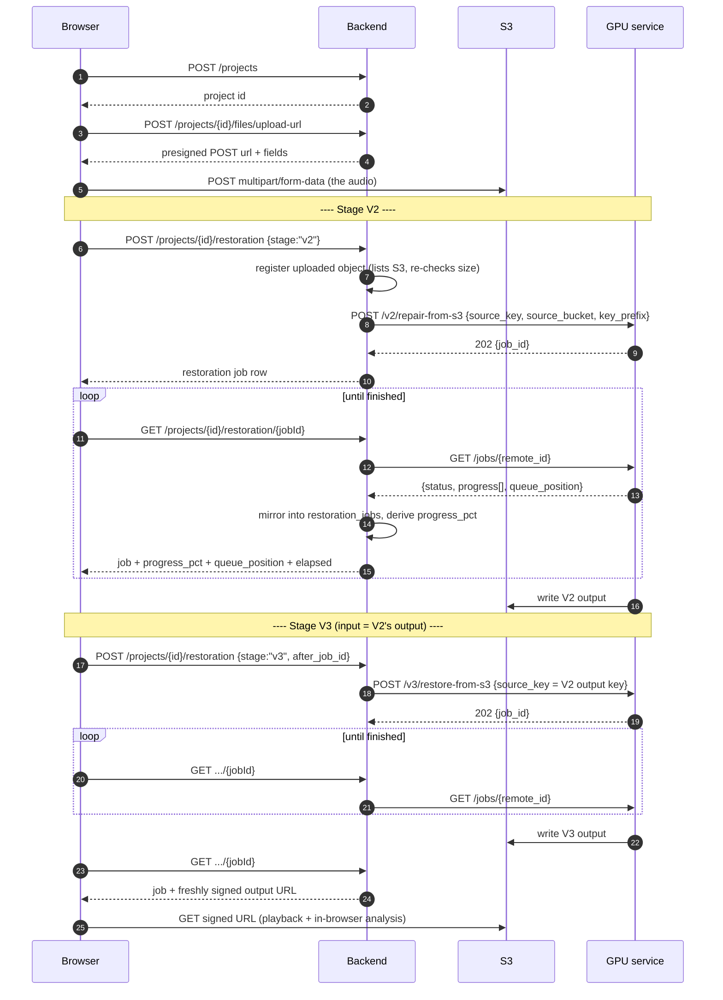
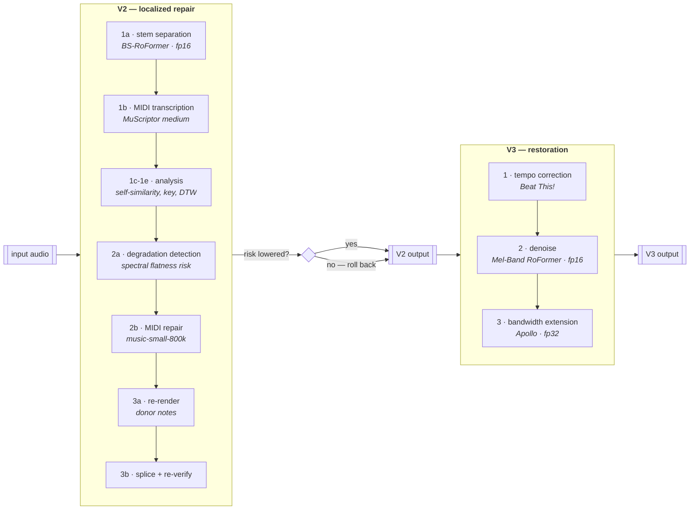

# Audio restoration — high-level design and manual UI test plan

Two things in one document:

1. **Design** — the three services, how they talk, and what the enhancement
   pipeline actually does inside the GPU host.
2. **Manual test agenda** — a step-by-step pass through the UI, with the expected
   result and the way to verify each step rather than assume it.

Restoration is **not** stem separation. Separation splits one track into stems;
restoration repairs and enhances a single piece of audio. Different pipeline,
different models, different service.

---

# Part 1 — High-level design

## 1.1 The three services



**The key property: audio never passes through an API process.** The browser puts
bytes directly into S3; the backend and the GPU service exchange **S3 keys**, not
files. A 200MB upload costs our API nothing but a presign.

| Service | Responsibility | Does NOT |
|---|---|---|
| **Frontend** (Next.js) | UI, upload, polling, in-browser measurement of results | talk to the GPU host — it cannot, see below |
| **Backend** (FastAPI) | auth, projects, quota, presigning, proxying, job durability | touch audio bytes, run models |
| **Restoration service** (GPU) | run V2 and V3, read/write S3 | know about users, projects, or plans |

### Why the backend proxies instead of the browser calling the GPU directly

The restoration service has **no CORS** and authenticates with a **static
`X-API-Key`**. Shipping that key to a browser would publish it. So the backend is
its only client and re-exposes the flow under the caller's own session auth.

## 1.2 Call sequence — one complete run



**Why V2 and V3 are two calls, not one.** V3's *input is the file V2 writes*. V3
cannot even be submitted until V2 has finished and its output key exists. That
ordering constraint is the entire reason they are separate jobs and separate
`restoration_jobs` rows.

Omitting `after_job_id` runs V3 straight off the original — restoration without
the repair stage.

## 1.3 Service contracts

**Browser → Backend** (JWT bearer, `/api/v1`)

| Method | Path | Purpose |
|---|---|---|
| `GET` | `/restoration/status` | is the feature available, and on what hardware |
| `POST` | `/projects/{id}/restoration` | start one stage; idempotent while that stage is in flight |
| `GET` | `/projects/{id}/restoration/{jobId}` | poll one run |
| `GET` | `/projects/{id}/restoration` | every run on the project |

**Backend → GPU service** (`X-API-Key` header)

| Method | Path | Purpose |
|---|---|---|
| `GET` | `/health` | open route; device, precision, VRAM, queue depth, warm |
| `POST` | `/v2/repair-from-s3` | queue a V2 job against an S3 key |
| `POST` | `/v3/restore-from-s3` | queue a V3 job against an S3 key |
| `GET` | `/jobs/{id}` | status, step log, queue position, outputs |

`source_bucket` matters on both POSTs: inputs live in `S3_BUCKET_INPUTS`, but the
GPU service defaults to its own results bucket, so omitting it looks in the wrong
place.

## 1.4 Durability — why the backend mirrors every poll

The GPU service keeps jobs **in memory**: 200 retained, evicted LRU, and **all of
them lost on restart**. It knows nothing about users or projects.

`restoration_jobs` in Postgres is what makes a run durable, ownable and
answerable after the fact. Consequences that are deliberate:

- A poll that 404s upstream marks the row **FAILED** rather than spinning forever.
- A row already `done` is **never re-fetched** — asking again would trade a stored
  result for a 404 after a restart.
- Output URLs are **signed per request, never stored** — the upstream's are 1h and
  would be dead on a page reload.

## 1.5 The enhancement pipeline



### V2 — localized repair

Assumes the input may contain **one** contiguous damaged span. It separates
stems to understand the track, transcribes it to MIDI, scores degradation risk
per frame, and flags at most one region. If a region is flagged it is regenerated
in MIDI and re-rendered from **real donor notes found elsewhere in the same
track**, then crossfaded back in.

**It then re-measures.** If the repair did not lower measured risk, it is rolled
back and the input passes through unchanged. This stage never touches material it
has no evidence about — so *"Unchanged"* is a correct, common outcome on clean
audio, not a failure.

### V3 — restoration

Three steps, individually switchable. **The order is fixed and load-bearing:**

1. **Tempo** first — the only step that touches the time axis. Running it later
   would re-stretch whatever the other steps had just repaired.
2. **Denoise** before bandwidth — super-resolution models synthesise the new high
   band from what sits below the cutoff; feeding them noise extends the noise.
3. **Bandwidth** last — the only step that changes sample rate.

Every enabled step runs **unconditionally and at full strength**. There is no
decision layer here. That is why the result must be checked rather than assumed —
which is what the comparison plots and `scripts/ab_quality.py` are for.

### Device and precision

| Stage | Device | Precision | Why |
|---|---|---|---|
| Separation (BS-RoFormer) | CUDA | **fp16** | `n_fft` 2048 — a power of two, which cuFFT requires for half-precision transforms |
| Transcription (MuScriptor) | CUDA | fp32 | `medium` by default; `large` is ~5.5GB staged through **system** RAM and risks an OOM kill |
| Denoise (Mel-Band RoFormer) | CUDA | fp16 | via audio-separator's torch path |
| Bandwidth (Apollo) | CUDA | **fp32** | STFT window is 882 samples — **not** a power of two, so cuFFT rejects it in fp16 |

`RESTORE_DEVICE=cuda` makes a GPU a requirement: the service refuses to start
without one rather than quietly serving CPU runs. Per-stage overrides
(`RESTORE_DEVICE_SEPARATE` / `_TRANSCRIBE` / `_AMT`) pin one stage to CPU on a
host that cannot fit all of them.

## 1.6 Concurrency

**One job at a time, deliberately.** A run peaks high enough that two do not fit
on the card; a single worker thread is what makes that impossible rather than
merely unlikely. Queue depth 16, then `503` with `Retry-After`.

A second submission of a stage already in flight returns the **running** job
rather than queueing a duplicate.

## 1.7 Progress reporting

The GPU service emits a **step log** (`list[str]`), not a percentage.

```
upstream: ["Fetching source audio", "Stage A / 1a - stem separation (BS-RoFormer)", ...]
   ↓  backend: restoration_progress.py maps steps → weighted milestones
   ↓  progress_pct (monotonic, capped < 100 until finished)
   ↓  + queue_position (transient) + elapsed_seconds
frontend: progress bar + step label + local elapsed timer
```

Frontend polls **adaptively** — 2s for the first minute, 5s to four minutes, 10s
after — because every poll reaches through to a GPU host that is busy running the
job. `GET /restoration/status` is cached 10s on the backend and shared across all
viewers.

---

# Part 2 — Manual UI test agenda

Work top to bottom. Each step has a **verification** — do that rather than
assuming the step passed.

## Pre-flight (before opening the UI)

| # | Action | Expected |
|---|---|---|
| 0.1 | `curl -s http://<gpu-host>:8000/health \| python -m json.tool` | `device: "cuda"`, `precision: "fp16"`, `warm: true`, `apollo: true`, `bucket_configured: true` |
| 0.2 | `grep -q '^HF_TOKEN=..' .env` on the GPU host | present — the MuScriptor weights are gated |
| 0.3 | `ss -lntp \| grep ':8000'` | only uvicorn. **Streamlit on 8000 breaks the API entirely** |
| 0.4 | Backend reachable | `/api/v1/restoration/status` returns `enabled: true, reachable: true` |

> `cuda: true` is **not** the same claim as `device: "cuda"`. A host with a GPU
> pinned to CPU reports the first and still runs everything on the second.

## T1 — Availability gating

| # | Action | Expected |
|---|---|---|
| 1.1 | Open `/restoration` | Options card + upload dropzone, no error banner |
| 1.2 | Check the option toggles | V2 repair, tempo, denoise, bandwidth, quality — all switchable |
| 1.3 | **Negative:** stop the GPU service, reload | Red banner "not responding right now"; dropzone **disabled** |
| 1.4 | Restart it, wait ≤60s | Banner clears without a page reload |
| 1.5 | **Negative:** remove Apollo from the host | Bandwidth toggle disabled, labelled unavailable |

## T2 — Upload

| # | Action | Expected |
|---|---|---|
| 2.1 | Drop a 30–60s WAV | Phase → "Create project", then "Upload to storage" |
| 2.2 | Watch the upload bar | Real byte progress to 100% |
| 2.3 | Network tab | `POST` goes **directly to S3**, not through our API |
| 2.4 | **Negative:** drop a `.txt` | Rejected client-side, no project created |
| 2.5 | **Negative:** drop a file over the plan limit | Rejected with the plan's limit named |

## T3 — V2 stage

| # | Action | Expected |
|---|---|---|
| 3.1 | Upload completes | Phase → "Version 2 — repair"; stage list shows it active |
| 3.2 | Progress bar | Advances; **never** reaches 100% while running; **never** goes backwards |
| 3.3 | Step label | Changes through real pipeline steps ("stem separation", "MIDI transcription (MuScriptor medium on cuda)", …) |
| 3.4 | Elapsed timer | Ticks every second — **between** polls, not only on poll |
| 3.5 | Poll cadence (network tab) | ~2s early, widening to ~5s after a minute |
| 3.6 | GPU host | `nvidia-smi` shows utilisation — proves it is not on CPU |
| 3.7 | **Concurrency:** start a second run from another browser | Second run shows "N runs ahead of yours" |

## T4 — V3 stage

| # | Action | Expected |
|---|---|---|
| 4.1 | V2 finishes | V2 marked done; phase → "Version 3 — restore" automatically |
| 4.2 | Request body of the V3 POST | Contains `after_job_id` = the V2 job id |
| 4.3 | Step labels | "Step 1 - tempo", "Step 2 - denoising", "Step 3 - extending bandwidth" |
| 4.4 | Progress bar | Continues forward from where V2 left it — does not reset |

## T5 — Results

| # | Action | Expected |
|---|---|---|
| 5.1 | Run completes | Phase → done; bar at 100% |
| 5.2 | Audio players | Original / V2 / V3 all play; playing one **pauses** the others |
| 5.3 | Waveform comparison | Three lanes, shared scale, original ghosted behind V2 and V3 |
| 5.4 | Per-lane summary | V2 on clean audio → *"identical to the original"*; V3 → a % difference, dB and length delta |
| 5.5 | Spectrum plot | Three curves on a log axis; V3 extending past the others = rebuilt high end |
| 5.6 | V2 decision card | Outcome, target stem, flagged region, risk before → after |
| 5.7 | V3 result card | Steps run, channels, sample rate, cutoff before → after |
| 5.8 | Reload the page, reopen the project | Result still available — URLs re-signed, not stale |

> **Expect V2 = "Unchanged" on clean audio.** It flags a span, attempts a repair,
> measures risk, and rolls back if the repair did not help. That is the safety
> mechanism working. To see V2 actually engage you need audio with a genuinely
> damaged span.

## T6 — Options behave as switches

| # | Action | Expected |
|---|---|---|
| 6.1 | Turn **V2 repair** off, run | V2 lane marked "skipped"; V3 runs on the original; roughly half the wait |
| 6.2 | Turn **denoise** off, run | V3 step log shows no denoise step |
| 6.3 | Turn **quality** on, run | Quality card appears with correlation and drift |
| 6.4 | Turn everything off, run | V3 completes having changed nothing measurable |

## T7 — Failure and recovery

| # | Action | Expected |
|---|---|---|
| 7.1 | Kill the GPU service mid-run | UI keeps polling; **does not** fail the run instantly (backend answers from its stored row) |
| 7.2 | Restart it, keep waiting | Job marked failed with "restarted before this run finished. Start it again." — **not** an infinite spinner |
| 7.3 | Click "Start over" mid-run | Polling stops; no orphaned requests in the network tab |
| 7.4 | Navigate away mid-run, come back to the project | Run is listed with its real status |
| 7.5 | Submit the same stage twice quickly | Second call returns the **running** job — no duplicate on the GPU queue |

## T8 — Access control

| # | Action | Expected |
|---|---|---|
| 8.1 | Call the restoration endpoints with no token | 401 |
| 8.2 | Poll another user's job id | 404 — not 403, which would confirm it exists |
| 8.3 | Inspect all frontend network traffic | **`X-API-Key` never appears.** It must not reach the browser |

---

## Sign-off checklist

- [ ] A full V2 + V3 run completes end to end
- [ ] `nvidia-smi` confirmed GPU utilisation during the run
- [ ] Progress bar monotonic, never 100% before done
- [ ] Waveform and spectrum plots render from real audio
- [ ] Queue position appears with two concurrent runs
- [ ] A mid-run GPU restart produces a clear failure, not a hang
- [ ] The GPU service's API key is absent from all browser traffic

## Known gaps at time of writing

- Full end-to-end run time has **not** been measured per stage. Measured so far:
  transcription 74.5s for 182.7s of audio; denoise separation 29s for 184.8s.
- The comparison plots have been verified against synthetic data and in a real
  browser, but **not** yet against real audio fetched from a signed S3 URL. If the
  stems bucket CORS differs from what `app/core/storage.py` sets, T5.3 and T5.5
  fail while the players and metric cards still work.
- GPU host port 8000 is reachable from the public internet and `/health` is
  unauthenticated — it reports GPU model and free VRAM to anyone who asks.
